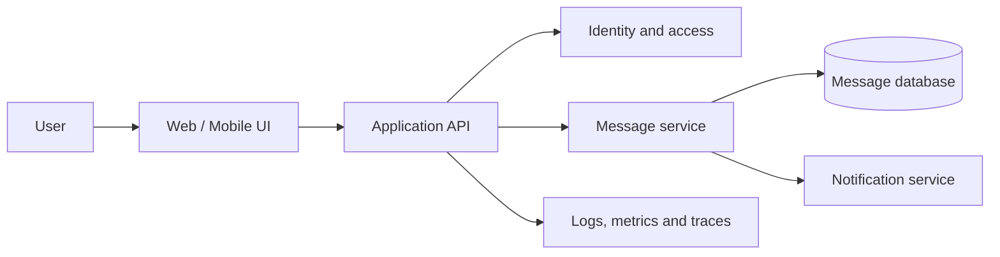

# Legacy application placeholder — Architecture & Interview Guide

This repository is currently a placeholder. The diagram below is an illustrative lifecycle for a future chat application and must not be represented as implemented functionality.

## Architecture diagram

## Interview questions

1. 1. What are the core components of a secure chat application?
2. 2. Why should the UI call an API rather than connect directly to a database?
3. 3. How would you authenticate users and authorize conversations?
4. 4. How would you store messages and preserve ordering?
5. 5. How would you scale WebSocket connections?
6. 6. How would you protect message data in transit and at rest?
7. 7. What metrics would you monitor for message delivery?
8. 8. How would you handle retries without duplicate messages?
9. 9. How would you design backups and disaster recovery?
10. 10. Which parts of this architecture are still only planned in this repository?

## Interview preparation note
Be ready to explain the design decision, security boundary, failure mode, operational signal and validation evidence for each answer. Clearly separate implemented code, CI-validated configuration, cloud-deployed resources and future roadmap items.

## Interview questions — suggested answers

### 1. Answer

A chat system typically has a client, authenticated API, message service, persistent store, real-time transport, notification worker and observability. This repository's diagram is a future design, not a deployed product.

### 2. Answer

The API is the trust boundary: it authenticates, authorizes, validates and applies business rules. Direct database access from clients exposes credentials and bypasses policy.

### 3. Answer

Authenticate users with a proven identity provider and short-lived tokens. Authorize every conversation operation against server-side membership, not just client-supplied IDs.

### 4. Answer

Store immutable message IDs, conversation IDs, sender IDs, timestamps and sequence/ordering metadata. Use idempotency keys and a defined ordering strategy per conversation.

### 5. Answer

Use a horizontally scalable WebSocket gateway with connection registry, shared pub/sub or event bus, heartbeat, backpressure and reconnect handling.

### 6. Answer

Use TLS in transit, managed encryption at rest, strict access controls, key rotation and careful logging that never records message bodies or tokens.

### 7. Answer

Track message publish-to-delivery latency, send success/error rate, queue lag, active connections, reconnects and notification failures.

### 8. Answer

Use idempotency keys, durable queues and retry with exponential backoff and jitter. A consumer should safely ignore an event already processed.

### 9. Answer

Back up message data consistently, test point-in-time restore, define RPO/RTO, replicate where required and exercise recovery rather than relying on backup existence.

### 10. Answer

Only the conceptual flow is documented here. Do not claim authentication, message persistence, WebSockets, notifications or deployment are implemented until code and test evidence exist.

## Complete zero-to-hero guide

See [ZERO-TO-HERO.md](./ZERO-TO-HERO.md) for the business scenario, architecture walkthrough, tool-by-tool explanations, implementation sequence, practical commands, troubleshooting playbook and additional scenario-based interview questions with answers.
