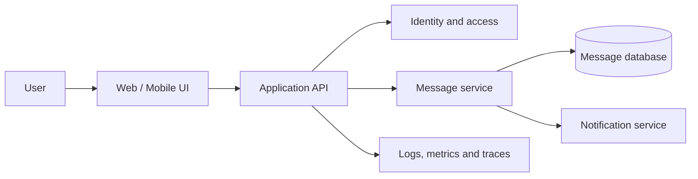

# Legacy application placeholder — Architecture & Interview Guide

This repository is currently a placeholder. The diagram below is an illustrative lifecycle for a future chat application and must not be represented as implemented functionality.

## Architecture diagram

## Interview questions

1. 1. What are the core components of a secure chat application?
2. 2. Why should the UI call an API rather than connect directly to a database?
3. 3. How would you authenticate users and authorize conversations?
4. 4. How would you store messages and preserve ordering?
5. 5. How would you scale WebSocket connections?
6. 6. How would you protect message data in transit and at rest?
7. 7. What metrics would you monitor for message delivery?
8. 8. How would you handle retries without duplicate messages?
9. 9. How would you design backups and disaster recovery?
10. 10. Which parts of this architecture are still only planned in this repository?

## Interview preparation note
Be ready to explain the design decision, security boundary, failure mode, operational signal and validation evidence for each answer. Clearly separate implemented code, CI-validated configuration, cloud-deployed resources and future roadmap items.
